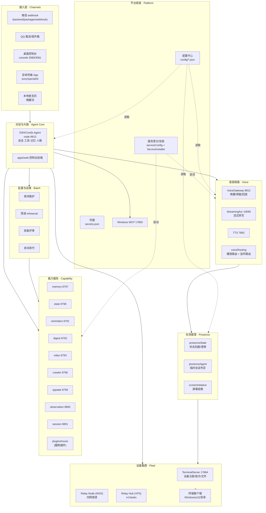

# SynLove 架构总览（v0.1 · 现状盘点）

> 目的：在重构前把「有什么、跑在哪、谁依赖谁」画清楚。本文只描述现状与目标边界，不含改造代码。

## 1. 一句话结构

```
对话/大脑（Node · DSH/Cordis）  ←→  能力服务（Python · HTTP/MCP）
        ↑                                    ↑
   微信 / QQ / 控制台                    设备集群（终端连接 / 中继 / 安卓）
```

- **大脑**：`SynLove-Personal-Agent/backend`（Node，端口 8813），负责会话、模型调用、工具编排、记忆、微信/QQ 接入。
- **能力服务**：Python，已按端口拆开（tts 7862、asr 8081、memory 8797、state 8798…），用 HTTP + MCP 暴露。
- **设备集群**：`SynLove-Terminal-Connection`（17864）+ `synlove-relay`（VPS）+ 安卓终端，负责远程控制、文件、语音信箱。
- **外围**：控制台 UI（3080/3081）、批量任务（夜间维护、预演、技能评审）、内容服务（酷狗、新闻、视频）。

## 2. 分层架构图

> 完整拓扑（25 个节点、6 类连线、7 处耦合热点）见[拓扑图](拓扑图.svg)；逐功能线清单见[架构明细图](架构明细图.svg)。


> 逐功能线的明细图（功能 → 实现文件 → 端口）见 [架构明细图](架构明细图.svg)，源文件由 `docs/架构明细图.svg` 随仓库维护。




## 3. 运行态清单（实测）

| 端口 | 进程 | 角色 |
|---|---|---|
| 8813 | node | 大脑（会话桥） |
| 3080/3081 | node | 控制台 |
| 8812 | python | 语音网关 |
| 10095 | python | 流式 ASR |
| 17864 | pythonw | 终端服务端 |
| 17865 | python | Windows MCP |
| 7862 / 8081 / 8080 | python | TTS / ASR / 本地 LLM |
| 8790–8801 | python | core/reminders/digest/video/crawler/memory/state/qqstate/observation/session |
| 9010(远端) | node | 中转 Hub |

计划任务 **33 个**（`SynLove-*`），其中常驻 5 个：VoiceGateway、StreamingAsr、TerminalServer、WindowsMcp、ApiHost；其余为按需/守护/批处理。

## 4. 代码量分布

| 区域 | 行数 | 性质 |
|---|---|---|
| `backend/packages` | ~520k | **上游框架**（@deepseek-ai DSH/Cordis）+ 构建产物，非自研 |
| `backend/packages/webhook` | ~20k | **自研**：微信接入、任务、记忆、画像、主动消息 |
| Python 各包（去掉 venv） | ~74k | **自研**：语音/在场/设备/能力服务/批量任务 |
| `plugins` | 24k | 工具插件：音乐、桌面、爬虫（8830） |
| `console` | 9.4k | 控制台（node + mjs） |
| `tools` | 7.3k | 运维与构建脚本（大头，可裁） |
| `services` + `microServices` | 4.2k | 服务框架（登记、租约、HTTP 适配） |
| `voice` + `voiceRouting` | 2.1k | 语音链路 |
| `presenceState` + `presenceAgent` | 0.9k | 在场推理（新） |
| `screenInitiative` | 0.7k | 屏幕观察 |
| 其余（memory/state/reminders/rehearsal/maintenance/skills…） | ~6k | 域能力 |
| `SynLove-Terminal-Connection` | 9.8k | 设备集群 |
| `Backend-Service` | 11.9k | GPU 运行时（TTS/ASR/Gemma/ModelHub） |

## 5. 核心 vs 边缘

| 判定 | 模块 | 理由 |
|---|---|---|
| **核心** | Agent Core(8813)、Webhook、Voice、Presence、Fleet | 直接决定「叫一声有没有反应」 |
| **核心** | memory、state | 人格连续性与设备状态 |
| **边缘** | digest / video / crawler / kugou | 内容消费，失败不影响对话 |
| **边缘** | rehearsal / nightly / skillReview / iteration | 批处理，可离线跑 |
| **边缘** | console / web | 展示层 |
| **可删/可并** | `tools/` 里的一次性迁移脚本、旧 KWS 训练、CNN 唤醒 | 已被替代 |

## 6. 耦合热点（有证据）

1. **跨仓库 `sys.path` 导入**：`tools/*.py`、`scripts/*`、`presenceState/*` 直接 `sys.path.insert` 到 `SynLove-Terminal-Connection`，两仓库无法独立部署。
2. **文件即接口**：`runtime/voiceRouting/{presence,listening,reasoning}.json` 被语音网关、屏幕观察、在场推理、控制台多方读写，改字段等于改协议。
3. **语音链路耦合路由**：`voicePipeline` 直接 import `voiceRouting` 与 `screenInitiative`，播放决策与在场判断混在一起。
4. **在场判断有两套**：`screenInitiative/PresenceInference`（规则）与 `presenceAgent`（模型），语义重叠、结论互相覆盖。
5. ~~**中转节点三份实现**~~（已解决）：节点实现统一为 `Backend-Service/relayNode`，模型节点跑 `--config config/modelNode.json`、业务节点跑 `config/node.json`，`synlove-relay` 只保留 Hub/部署用途；`RelayServerNode.py` 仍承载 `terminal.connection`，待迁移。
6. **配置分裂**：`devices` / `allowSpeaker` 同时存在于 `screenInitiative.json` 与 `audioRouting.json`；40+ 个 JSON，键名重叠。
7. **状态分散**：`runtime/*.json`、SQLite（devices/sessions）、图谱记忆（dsh）、内存态（reasoner.decision），无统一读写入口。
8. **启动靠 33 个计划任务**，顺序隐含在脚本里（StartupServices/ServiceInstaller），没有单一 supervisor 与健康总览。

## 7. 目标边界（建议的微服务）

| 服务 | 拥有 | 对外契约 | 迁移难度 |
|---|---|---|---|
| **Agent Core** | DSH/Cordis、会话、模型、工具编排 | `POST /v1/voice/reply`、MCP | 保留 |
| **Channel Gateway** | 微信/QQ/控制台/安卓统一入口 | `POST /v1/channel/{wechat,qq,console}` | 中 |
| **Voice Service** | 唤醒、ASR 会话、TTS、回放 | `POST /v1/voice/*`、`WS /v1/asr` | 中 |
| **Presence Service** | 状态刻画、漂移、地点、agent 判定、监听目标 | `GET /v1/presence`、`POST /v1/presence/refresh` | **低（已基本独立）** |
| **Fleet Service** | 设备注册、指令、文件、声音信箱、中继 | `POST /v1/devices/*`、MCP 工具 | 中 |
| **Capability Services** | memory/state/reminders/digest/video/crawler/qqstate/observation/session | 已按端口独立 | 低 |
| **Media Service** | 酷狗、媒体推送 | `POST /v1/music/*` | 低（整块搬） |
| **Batch Service** | 夜间维护、预演、技能评审、自动迭代 | 定时触发 | 低 |
| **Console** | 控制台 UI | 只读 API | 低 |
| **Platform** | 服务登记、supervisor、配置、凭据、日志 | `serviceConfig` 单一来源 | 高（但收益最大） |

## 8. 拆分顺序（按风险从低到高）

1. **契约冻结（不改代码）**：把 `runtime/voiceRouting/*.json` 标成 Presence Service 私有，其他服务只能通过 HTTP 读；给跨仓库 import 加架构测试（禁止 `sys.path.insert`）。
2. **抽出 Presence Service**：它现在只依赖「终端快照 + 地点 + 模型」，把 `presenceState/`、`presenceAgent/`、`screenInitiative/` 合到一个进程与端口，删掉重复的规则实现，`voiceRouting` 只保留「按结论下发指令」。
3. **抽出 Fleet Service**：`SynLove-Terminal-Connection` 只通过 HTTP/MCP 暴露，去掉所有 `sys.path` 直连（relay 节点已合并为一份）。
4. **Voice 瘦身**：`voicePipeline` 只依赖 Presence/Fleet 的 HTTP 契约，不再 import 领域模块。
5. **配置与 supervisor 统一**：`config/system.json`（分节：voice/presence/fleet/channels），一个 supervisor 拉起全部服务并暴露 `/health` 汇总。
6. **批量任务外迁**：维护/预演/评审独立进程，失败不影响主链路。

## 9. 每一阶段的验收

- 架构测试通过：服务间零 `sys.path`、零跨服务文件读写
- 每个服务可单独重启，主链路不中断
- `docs/端口与服务.md` 与实际监听一致
- 单服务 LOC 与依赖数下降，重复实现清零（presence 规则、relay 节点）

## 10. 立即可做的降代码量动作（不改行为）

1. 删除已被替代的实现：旧 KWS（2024 权重与训练脚本）、CNN 唤醒、`tools/` 里的一次性迁移脚本
2. ~~合并三份 relay 节点为一份~~（已完成 2026-11-27）：模型节点与业务节点共用 `relayNode` 实现；备份见 `备份/RelayMergeV1.0`
3. `screenInitiative/PresenceInference` 与 `presenceAgent` 二选一：规则保留为「兜底函数」，不再独立成模块
4. `kugou` 整块移出主仓库，作为独立 Media Service 部署
5. 把 `runtime` 里的大文件（llm-probe.log 327MB、dsh 276MB）移出代码目录

## 12. 运行事实（2026-11-27）

- `8810 ModelHub` 计划任务自 11-18 起为异常退出状态（`LastTaskResult=0xFFFFFFFF`），
  导致在场/观察模型全部 `URLError`，回退到规则。已重启恢复，`/v1/gpu/status` 正常。
  该服务是所有云端模型的统一出口，需纳入守护。
- relay 节点：`SynLove-Node` 现在只启动 `relayNode/dist/tools/startNode.js --config <配置>`，
  模型节点（chat/tts/asr）与业务节点（crawlerCenter/webCollection/scheduler/video）共用同一实现。

### TTS / ASR 集体卡死的真实原因（2026-11-27 定位）

1. `GpuCoordinator.release_peers()` 遇到同伴服务已停止时抛连接错误，被判成
   「无法确认同伴已安全卸载」；`ensure_memory()` 在 `wait=true` 下无限重试，且**一直持有
   `runtime/gpuResidency/model.lock`**。结果 LLM 进程把执行锁占死（`state.json` 显示
   `phase=waitingPeerRelease`），TTS、ASR 的所有请求都在 `request_slot()` 排队，最长等 1200 秒后 503，
   期间日志只有启动两行，看起来像「TTS 卡死」。
2. `breezeTtsService.py` 缺 `BREEZE_REPO` 时 `from models.breeze` 失败，同样表现为请求悬挂。
   现已改为启动即报错并给出路径，且会自动定位同级仓库的 `vendor/breeze-tts`。
3. 修复：连接被拒绝/重置视为该同伴未运行（不可能占显存）；同伴等待设 120 秒上限，超时抛错并释放锁。

### 微信外发入口（2026-11-27）

- 唯一入口：`POST http://127.0.0.1:3081/admin/send-text`，body `{text, user_id?}`。
  它把文本排队进既有 outbox，再由 `OutboundCoordinator` 走 iLink 发送，不另写一套协议。
- 消息网关侧：`channels/WeixinSender.py` → `POST /v1/outbound {channel:"weixin"}`，
  已注册进 `registered=["qq","voice","weixin"]`。
- 收件人：显式 `user_id` 优先，否则取最近一个真实微信用户（`@im.wechat`）；
  不会误用 `rehearsal@local` 这类预演注入的假用户。
- 平台约束：iLink 的 `context_token` 新鲜度很短，过期后无法主动发送（`ret=-3`）。
  因此无新鲜 token 时直接返回「微信会话窗口已关闭：需要用户先在微信里说一句话」，
  不硬发、不写终态失败。阈值可用 `DSH_WEIXIN_PROACTIVE_TOKEN_MS` 调整（默认 10 分钟）。
- 构建注意：该包没有本地 `tsc`，`src/*.ts` 与 `lib/types/*.js` 必须同步修改。

### 语音链路恢复（2026-11-27）

三处配置错误叠加，导致 `/v1/audio/route speak` 一直失败：

1. `serviceConfig.tts.model` 仍是占位符 `your-tts-model`、缺 `dialect`；
   `ServiceClient.synthesize` 因此拒绝转发参考音（`refAudioBase64`）→ 500/400。已改为
   `model=breeze-tts-2`、`dialect=breeze`、`format=wav`。
2. `voiceConfig.ttsStreamingEnabled=true` 让客户端请求 `response_format=pcm`，
   而 Breeze 只支持 wav（`Breeze 服务只支持 response_format=wav`）→ 400。已关闭。
   服务端本来就是整段返回，流式没有收益。
3. `serviceConfig.tts` 缺 `apiKeyRef`，SYSTEM 进程读不到用户环境里的密钥 → 401。已补 `apiKeyRef=tts`。

验证：`POST /v1/outbound {channel:"voice"}` 返回 `{"state":"played","target":"tianxuanLaptop"}`，42.8 秒。

## 13. 目录收敛与拆库（2026-11-28）

生产根 `G:\SynLove-houtai` 现在按职责分层：

| 目录 | 内容 |
|---|---|
| `repos/` | `personal-agent`、`terminal-pc`、`backend-service`、`sdk`、`relay` |
| `ops/` | 计划任务入口、启动脚本、看门狗 |
| `external/` | 模型权重与外部引擎（`models`、`llama.cpp`、`aceStepXlBase`、`mossSoundEffect`、`rsshub-build`） |
| `data/` | `graph`、`timeline`（`runtime/dsh` 下以联接指回，服务无感） |
| `skills/` | `production`、`rehearsal`（同上，联接回 `runtime/dsh`） |
| `models/` | `config/`（现行模型与服务配置的只读视图）、`docs/模型与接口.md` |
| `forks/xinai/` | 欣爱自迭代副本：只含代码，不含权重/虚拟环境/运行数据 |
| `archive/` | 备份归档、一次性脚本、旧版本 |

### 设备管理已迁出终端库

原 `terminalConnection/server` 下的设备管理模块迁到 `repos/backend-service/fleetService/`：
`DeviceStore`、`DeviceRegistry`、`TerminalManager`、`TerminalAdminHandler`、`DeviceProfile`、
`CapabilityTable`、`VoiceMailbox`、`VoicePlaybackRouter`、`AudioRouteClient`。

- 终端库只保留终端侧：`client/`、`transport/`、`fileTransfer/`、`completion/`、`music/`、
  `security/`、`privacy/` 以及 `RelayServerNode`、`ServerLocalDevice`。
- 17864 仍由 CoreService 进程内的 `TerminalServerRuntime` 托管，但改为从 `fleetService` 导入；
  `backend-service` 通过 `.pth` 加入解释器路径。
- PA 侧引用点已全部改为 `fleetService.*`：`facts/FactsService`、`remoteControl/TerminalServerRuntime`、
  `screenInitiative/screenTerminal`、`scripts/runFactsService`。

### PA 实体目录已搬入 repos

`G:\SynLove-houtai\SynLove-Personal-Agent` 的实体内容已搬到 `repos/personal-agent`
（`robocopy /MOVE`，源目录只剩 3 个 0 字节空壳，因句柄占用留待重启后删除）。

搬移中丢失的是工作区 `node_modules` 的联接（`/XJ` 跳过 reparse point），
已按各包 `package.json` 的 `name` 重建 254 个联接，Node 侧恢复。

## 14. 配置迁移与相对化（2026-11-28 续）

### 模型配置物理位置

真实文件现在位于 `models/config/`：

`modelConfig.json`、`serviceConfig.json`、`secrets.json`、`modelHub.server.json`。

原 `config/` 下保留同名**文件符号链接**，因此 25 处历史读取点无需改动即可继续工作；
写入（`switch_model`、`weixin_login`）会透过链接落到真实文件。

### 统一路径解析

新增 `synlove_sdk.paths.ProjectPaths`：

- `production_root(start)`：向上找到同时包含 `repos` 与 `models` 的目录，不再依赖盘符；
- `model_config_dir(root)`：环境变量 `SYNLOVE_MODEL_CONFIG_DIR` 优先，否则 `<生产根>/models/config`；
- `model_config(root, name)`：返回配置文件，缺失直接报错，不回退旧目录。

已接入：`start_stack`、`ServiceRegistry`、`ServiceCredential`、`PresenceModelClient`、
`screenModel`、`GpuCoordinator`。其余读取点由符号链接兜底。

### 脚本相对化

`ops/*.ps1`、`ops/*.cmd` 的根目录改为 `$PSScriptRoot` / `%~dp0` 推导；
`repos/backend-service/deploy/*.cmd` 使用 `%~dp0..`。
计划任务参数仍是绝对路径（Task Scheduler 要求），这是唯一保留的绝对位置。
`ops/tests/stress-test.py` 也已相对化；一次性维护脚本移入 `archive/one-off/`。

### SDK 终端交付

`repos/sdk/deploy/` 提供：

- `synlove-sdk.zip`：SDK 源码包；
- `InstallSynLoveSdk.ps1`：写入 `SynLoveSdk.pth` 并自检导入；
- `README.md`：PC 安装步骤；说明安卓端为 Java，不使用 Python SDK。

服务器本机已用该脚本验证通过。`tianxuanLaptop` 与 `sonyXperia5III` 当前离线，
需设备上线后再执行安装。
